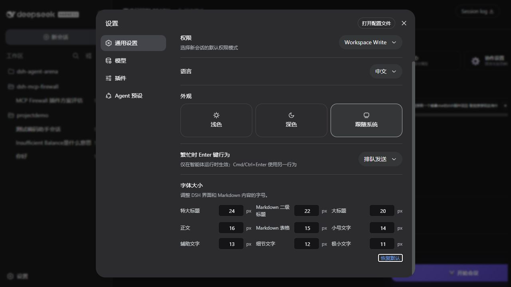

# dsh-font-size

Adjust the native DSH font sizes from **Settings -> General settings**.

在 DSH 原生 **设置 -> 通用设置** 中调整界面和 Markdown 内容的字号。

## Features / 功能

- Nine native size slots: `11px`, `12px`, `13px`, `14px`, `15px`, `16px`, `20px`, `22px`, `24px`.
- 原生 9 种字号：`11px`、`12px`、`13px`、`14px`、`15px`、`16px`、`20px`、`22px`、`24px`。
- Values are edited in pixels and accept integer values from `8px` to `80px`.
- 单位为 `px`，支持输入 `8px` 到 `80px` 的整数值。
- Changes apply immediately and persist in the DSH settings document.
- 修改后立即生效，并持久化到 DSH 设置文件。
- Reset restores the original DSH defaults.
- “恢复默认”会恢复 DSH 原生默认值。
- Setting labels and descriptions follow the active DSH language (Chinese / English).
- 设置名称和说明会跟随 DSH 当前语言（中文 / English）切换。

## Default values / 默认值

| Slot | Default / 默认 |
| --- | ---: |
| Extra small text / 极小文字 | `11px` |
| Detail text / 细节文字 | `12px` |
| Supporting text / 辅助文字 | `13px` |
| Small text / 小号文字 | `14px` |
| Markdown table / Markdown 表格 | `15px` |
| Body text / 正文 | `16px` |
| Large heading / 大标题 | `20px` |
| Markdown H2 / Markdown 二级标题 | `22px` |
| Extra large heading / 特大标题 | `24px` |

## Installation / 安装

Install this package through the DSH plugin manager, or add it to the web profile's plugin dependencies. The plugin targets DSH `0.1.0-rc.6`.

通过 DSH 插件管理器安装，或将此包加入 web profile 的插件依赖。当前目标版本为 DSH `0.1.0-rc.6`。

This package declares Node.js 22 or newer in its `engines` field.

此包在 `engines` 字段中声明需要 Node.js 22 或更高版本。

## License / 许可证

MIT
